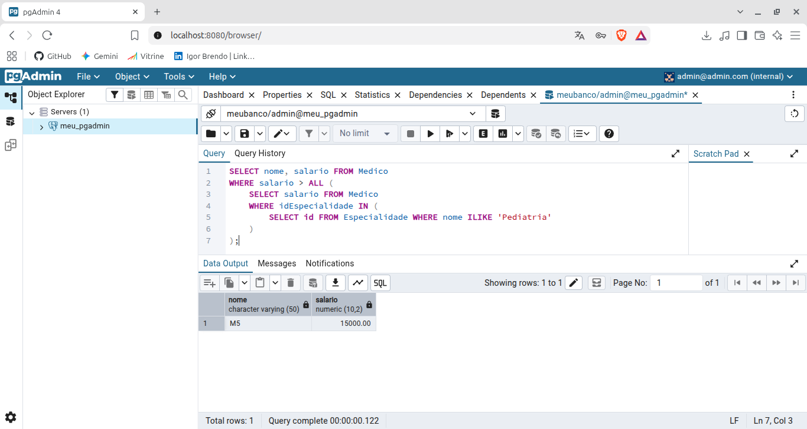
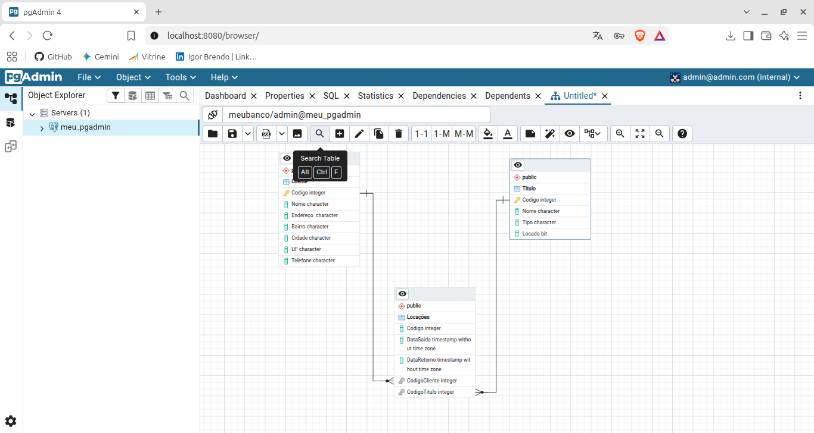
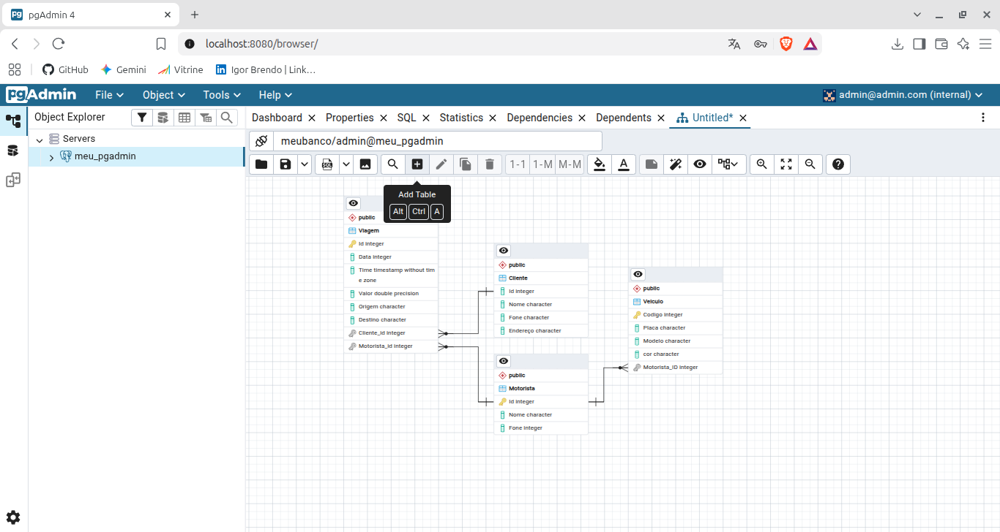

# Atividades Praticas de Banco de Dados - PostgreSQL e pgAdmin 4 via Docker

Este repositorio contem os scripts, modelos relacionais e diagramas ERD desenvolvidos para as atividades praticas da disciplina de Banco de Dados, ministrada pelo professor Mateus de Paula na UNIP.

## Visao Geral dos Laboratorios

| Modulo | Tópicos Abordados | Arquivo Principal |
| :--- | :--- | :--- |
| **01. Automacao e CRUD** | Configuracao de ambiente (`venv`, `.gitignore`) e manipulacao de dados em SQLite via Python. | `aula1.py` |
| **02. Modelagem Relacional** | Integridade referencial (`FOREIGN KEY`), filtros (`WHERE`) e juncoes com agrupamento (`INNER JOIN`, `GROUP BY`, `HAVING`). | `aula2.py` |
| **03. Povoamento em Lote** | Insercao massiva nas tabelas `country` e `city`, ordenacao (`ORDER BY`) e funcoes de agregacao (`SUM`, `AVG`, `COUNT`). | `aula3.py` |

## Resolucao da Lista de Exercicios (Questoes 10, 14 a 20)

Execucao de queries e subconsultas SQL diretamente na interface do pgAdmin 4 via Docker Compose.

[Acessar Resolucao Teorica em PDF](png/Banco%20de%20dados%20-%20Lista.pdf)

### Estrutura do Projeto
* `docker-compose.yml`: Configuracao dos servicos PostgreSQL e pgAdmin 4.
* `script_lab4.sql`: Script SQL das questoes 10 e 14 a 20 (criacao de tabelas, insercoes e subconsultas).

### Execucao das Queries (pgAdmin 4)

#### Filtro de Texto com ILIKE e Substring (Questão 10)
.png)

#### Filtro de Datas com BETWEEN e Subconsulta (Questão 16)
.png)

#### Comparação de Conjuntos com Predicado ALL ou ANY (Questão 18)

## Laboratorio 5: Diagramas de Modelo Logico (ERD)

Modelagem de entidades e definicao de relacionamentos de Chaves Estrangeiras (`Foreign Keys` / 1:N) utilizando a ferramenta visual ERD Tool do pgAdmin 4.

### 1. Modelo Logico de Locadora
Estruturacao das tabelas `Cliente` e `Titulo` associadas a tabela `Locaçoes`.

### 2. Modelo Logico de Transporte e Viagens
Mapeamento das entidades `Veiculo`, `Motorista`, `Cliente` e os relacionamentos 1:N com a tabela `Viagem`.

